  

  
  
  

 

### Sobre

Desenvolvedor full-stack na **Copapel**, construindo sistemas internos de ponta a ponta: PDV, WMS e portais,
integrações com **SAP Business One / HANA**, pipelines de CI/CD e automações com **n8n**.
Fora do trabalho, estudo **ciência de dados, machine learning e sistemas multi-agente** e faço jogos nas horas vagas.

### Stack

  
   
  

  
  
  
  

### Projetos

  
  
  
  
  
  

  

